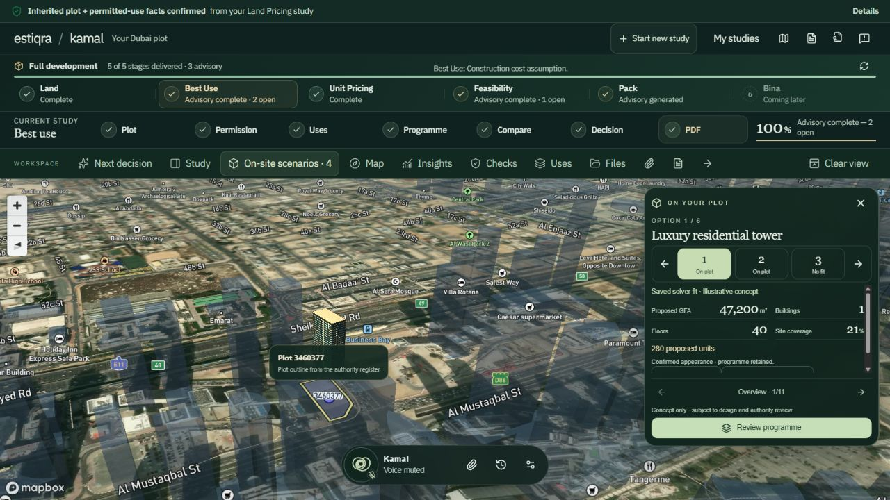
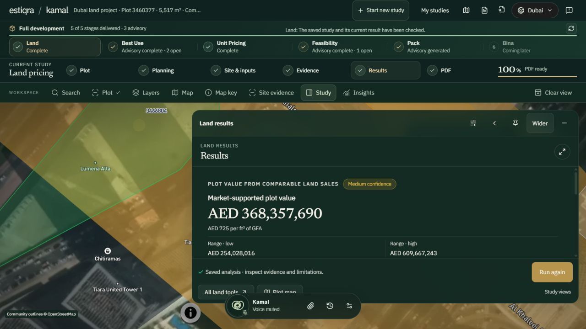

# Estiqra

### Real estate intelligence, built from evidence.

**A connected workspace for development, investment, and advisory teams to move from property evidence to reviewable analysis and decision reports.**

[Website](https://www.estiqra.com/) · [Product preview](https://www.estiqra.com/#product-journey) · [Tavora report and inventory](reports/README.md) · [Request early access](https://www.estiqra.com/#contact)

**Status:** early access. The public product demonstration features a Dubai pilot.

## The problem

A real estate decision often starts with information spread across documents, transaction records, planning material, maps, and spreadsheets. Teams spend time reconciling those inputs, then struggle to keep the evidence and assumptions attached to the conclusion.

## The product

Estiqra connects that work in one place: bring in evidence, organize it, run analysis, review the assumptions, and produce a report. AI assists the workflow while the team retains control over the final advisory output.

**Evidence → analysis → human review → decision report**

## Product in view

### Kamal · Dubai Full Development

An actual saved Dubai pilot test study in Kamal mode, captured on 12 October 2026. The Full Development path connects **Land → Best Use → Unit Pricing → Feasibility → Pack**. The map places the saved development concept on its plot while the stage status and open advisory items stay visible. The building is an illustrative concept subject to design and authority review.

### Kamal · Dubai Land Pricing

The linked Land Pricing study shows the plot context beside its saved pricing result, confidence, and range. This capture is from the same Dubai pilot test journey. It demonstrates the workspace and review flow; the displayed figures are a dated test output, not a current certified valuation.

[View the short Tavora pricing report and matching inventory](reports/README.md)

## Product workflows

The public product overview presents the following workflows. Availability depends on the report path and evidence readiness.

| Workflow | Decision it supports |
| --- | --- |
| **Land and plot pricing** | Review comparable evidence and a development view of land value. |
| **Best Use** | Assess a site's potential with planning context and scenario analysis. |
| **Unit pricing** | Review pricing at the unit level. |
| **Feasibility** | Evaluate development scenarios and their financial assumptions. |
| **Capital markets** | Prepare structured investment and advisory analysis. |
| **Broker packs** | Prepare evidence for seller pricing, buyer due diligence, negotiation, and area comparisons. |

## Who it is for

- Developers and development teams evaluating sites and projects.
- Investors and asset managers reviewing opportunities.
- Analysts and advisors preparing evidence-backed recommendations.
- Brokers supporting client pricing and due-diligence decisions.

## What makes the approach distinctive

- **Connected evidence:** the source material remains visible through analysis and reporting.
- **Reviewable assumptions:** teams can examine the inputs behind a conclusion.
- **Human control:** AI assists the work; people govern the final output.
- **Real estate context:** the product starts with property, planning, market, and financial evidence.
- **GCC starting point:** the public demonstration is a Dubai pilot, with a broader market expansion vision.

## Public proof of the product

| Evidence | Where to see it |
| --- | --- |
| Public product website | [estiqra.com](https://www.estiqra.com/) |
| Pilot video and workspace captures | [Product preview](https://www.estiqra.com/#product-journey) |
| Selected public report samples | [Tavora pricing sample and matching inventory](reports/README.md) |
| Pilot access and product conversations | [Contact / early access](https://www.estiqra.com/#contact) |

The public samples contain one short Tavora pricing report and its matching 95-unit inventory, abridged from the same archived test dated 2 August 2026. The samples retain the case context and advisory limits. They demonstrate report output, not current market advice, a certified valuation, or a customer engagement. The Kamal screenshots show a separate Dubai pilot study.

## Founder and direction

Estiqra is founded by **Rdwan Mousa**, whose public profile combines real estate domain expertise, full-stack product development, AI-assisted engineering, and geospatial and financial systems.

The direction is to make evidence-led real estate decision support a connected workflow, beginning with the Dubai pilot and extending market by market.

[Founder profile](https://github.com/mosaradwan-star) · [Product and investor enquiries](https://www.estiqra.com/#contact)

## About this repository

This is a public product showcase for customers, partners, and investors. It contains product documentation, two Kamal product captures, and one short Tavora pricing report and its matching inventory, with cover previews. Estiqra's application source code, credentials, private datasets, and customer information are not included.

Product descriptions follow the [public Estiqra website](https://www.estiqra.com/). Kamal screenshots and the selected public samples were reviewed on 12 October 2026.

© 2026 Estiqra. All rights reserved. This showcase does not grant rights to Estiqra's proprietary software or brand assets.
