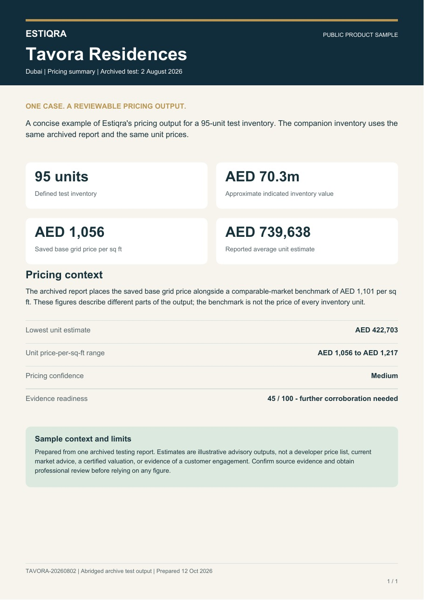
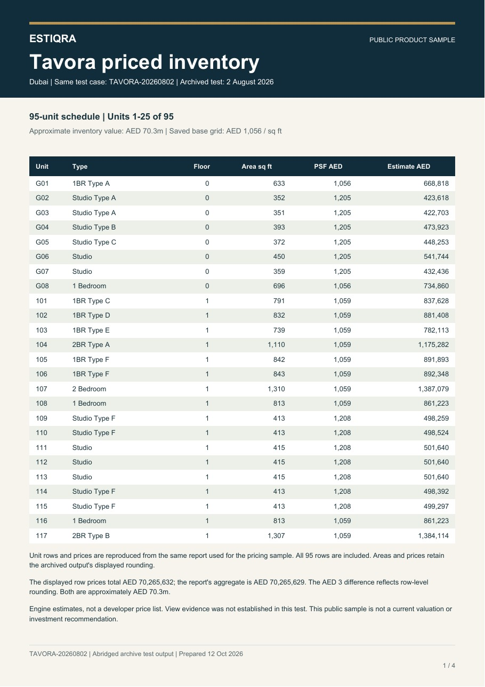

# Tavora public samples

**One short pricing report. One matching inventory.**

[Back to the product showcase](../README.md#product-in-view) · [Estiqra website](https://www.estiqra.com/) · [Product / investor enquiries](https://www.estiqra.com/#contact)

Both PDFs use the same 95-unit Tavora test case dated **2 August 2026**. These public editions were abridged from a saved Estiqra report and prepared on 12 October 2026. The inventory retains all 95 displayed unit rows and their archived prices; the pricing summary refers to that same schedule. Original rounding and relevant qualifications are explained in the samples.

| Sample | Pages | Open / download |
| --- | ---: | --- |
| Short Tavora pricing report | 1 | [Pricing sample](tavora-pricing-sample.pdf) |
| Matching Tavora priced inventory - 95 units | 4 | [Inventory sample](tavora-matching-inventory.pdf) |

## Preview the samples

| Pricing report | Matching inventory |
| --- | --- |
|  |  |

These are archived testing outputs presented as product samples. They are not a developer price list, current market advice, certified valuations, or evidence of a customer engagement. The Kamal screenshots show a separate saved Dubai pilot study.

For a product walkthrough or investor conversation, [contact Estiqra](https://www.estiqra.com/#contact).
